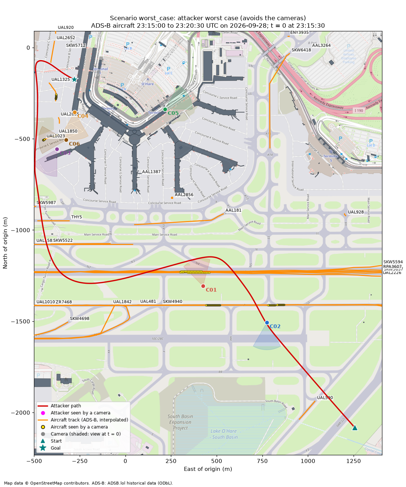
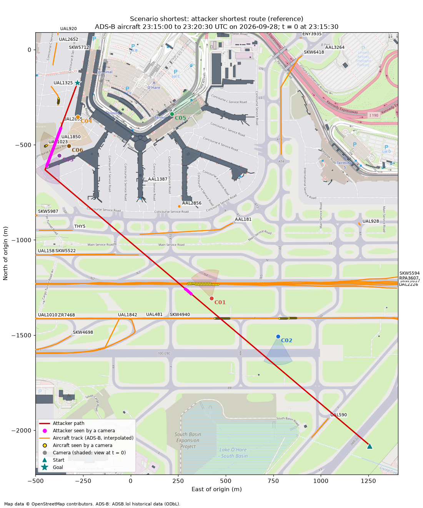

# ORD runway crossing: attacker paths with real ADS-B traffic

This package is for intent inference. It combines three things on one clock:

- the surveillance scene `ord_runway_crossing_10m` (SYGARD-Dataset commit `ba529e5`): buildings, 6 rotating cameras, start and goal;
- the two attacker drone paths from the path-planning team;
- real aircraft from ADS-B at Chicago O'Hare on 2026-09-28, 23:15:00 to 23:20:30 UTC. The aircraft are the friendly agents.

There are two scenarios, one per attacker path. They share the scene and the aircraft; only the attacker differs.

| Scenario | Attacker | Flight time | Attacker seen | Camera detections (attacker / aircraft) |
|---|---|---|---|---|
| `scenarios/worst_case/` | path planned to avoid the cameras | 274.8 s | 0.0 s | 0 / 351 |
| `scenarios/shortest/` | shortest route, ignores the cameras | 181.9 s | 17.5 s (C01 3.0 s, C03 14.5 s) | 175 / 351 |

A camera detection is one camera seeing one agent at one 0.1 s step.

## Time and frame

- `t_s` = 0 is the attacker launch, 2026-09-28T23:15:30Z. The scene runs from t = -30 s to 300 s. The aircraft are present for the whole span. The attacker appears at t = 0 and stops at the goal.
- Positions are in the dataset's ENU frame, in metres: origin 41.980103 N, 87.903868 W, at 2250 m altitude. Ground is at up = -2083.2 m. The attacker flies at 10 m above ground.
- Aircraft heights come from the ADS-B altitude minus 2250 m. An aircraft reporting "on ground" is put at ground level.

## Agents

38 aircraft were inside the planning area at some time in the span. 33 of them were on the ground for at least part of it. `scenarios/<name>/agents.json` lists every agent with its role (`adversary` or `friendly`), ICAO address, callsign, registration and type.

Aircraft seen by at least one camera (the same in both scenarios):

| Callsign | Type | Cameras | Seen (s) |
|---|---|---|---|
| UAL481 | B737 | C02 | 3.9 |
| DAL2226 | BCS3 | C01 | 0.5 |
| UAL1850 | B738 | C03, C06 | 5.3 |
| GJS4502 | CRJ7 | C01 | 0.7 |
| UAL1023 | B739 | C03, C06 | 5.0 |
| SKW5594 | CRJ7 | C01 | 1.6 |
| RPA3607 | E75L | C01 | 1.5 |
| UAL1010 | B738 | C01, C02 | 10.9 |
| UAL1325 | B738 | C04 | 5.7 |

## Files

| Path | Contents |
|---|---|
| `scene/` | The surveillance scene, unchanged: `problem.json`, buildings, blind areas, `seen.py`, the 10 Hz camera schedule from t = 0, the scene map and its README. `camera_headings_10hz.jsonl` adds every camera heading from t = -30 s to 300 s. |
| `attacker_paths/` | The path-planning team's two files and README, unchanged. |
| `adsb/adsb_reports.jsonl` | Every ADS-B report in the span: time, ICAO address, callsign, type, latitude, longitude, altitude, on-ground flag, ENU position, speed, heading and the source the report came from. |
| `adsb/aircraft_tracks_10hz.jsonl` | Each aircraft every 0.1 s, interpolated linearly between reports. |
| `scenarios/<name>/truth_10hz.jsonl` | Every agent every 0.1 s: position, `seen_by` and `in_view_any_range`. |
| `scenarios/<name>/observations.jsonl` | What a monitoring system would receive: every ADS-B report and every camera detection, in time order. |
| `scenarios/<name>/agents.json` | The agent list. |
| `scenarios/<name>/overview.png` | Map of the attacker path, aircraft tracks and cameras. |
| `scenarios/<name>/scenario.mp4` | The rotating camera views with the attacker and aircraft, at 5x speed. |

## How "seen" is computed

`seen_by` uses the dataset rule in `scene/seen.py`. A camera sees an agent when it is within ±30° of the camera heading, within 150 m horizontally, and no building blocks the straight line between them. Every value was checked against `seen.py`.

`in_view_any_range` drops the 150 m limit and adds the camera's vertical field of view (camera pitched 15° down, 36° vertical view). It lists the cameras whose image would contain the agent at any distance, which matters for aircraft in the air.

For aircraft on the ground, line of sight is checked to a point 4 m above ground, roughly the centre of a fuselage. Aircraft outside the planning area are not checked.

## Limits

- Camera detections are ideal. They give the agent's true position with no noise, no misses and no false alarms. Add a sensor model if you need one.
- Aircraft positions between reports are straight-line interpolations. A gap longer than 30 s is left empty rather than filled.
- ADS-B shows only aircraft that broadcast it. Ground vehicles and aircraft without ADS-B are not in the data.
- The attacker paths are the path-planning team's, unchanged. Their own `seen_by` values agree with the recomputed ones at every sample (2749 of 2749 for the worst case, 1821 of 1821 for the shortest route). The shortest route starts 4.43 m from the scene's start point; the worst case starts 0.0 m from it.

Map data © OpenStreetMap contributors. ADS-B data: ADSB.lol historical data, ODbL.
