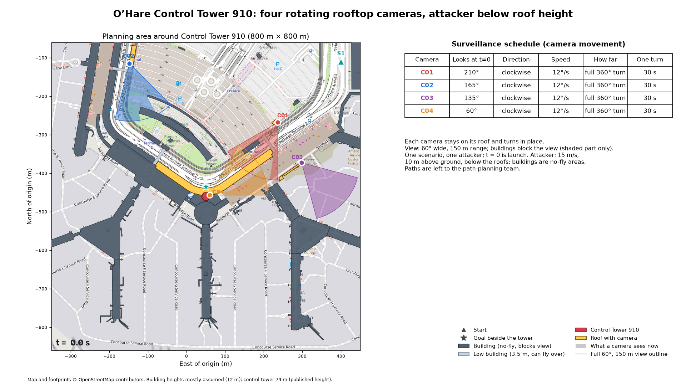

# Surveillance problem: ORD Control Tower 910, rotating rooftop cameras, attacker below roof height

Coordinates are local east, north, up (ENU) in metres. Origin 41.980103 N, 87.903868 W at 2250 m altitude (the same frame as the earlier SYGARD trajectory dataset), so ground is z = -2083.2 m, not 0.

## The five inputs

| Input | Where |
|---|---|
| Map | `planning_area_enu_m` in `problem.json` (800 m x 800 m square centred on the tower); `handoff_map.png` |
| Building positions | `buildings_enu.json`: 124 outlines in ENU metres with heights. The 121 taller than 10 m are no-fly areas. The same buildings in longitude/latitude: `buildings_lonlat.geojson` |
| Start and goal | `scenarios` in `problem.json` |
| Attacker speed | `attacker.speed_mps` = 15 m/s, flying 10 m above ground |
| Surveillance schedule | `schedule` of each camera in `problem.json`; what each camera sees every 0.1 s in `camera_schedule_10hz.jsonl` |

Scenario s1_ne_low: start at the north-east corner (399.9, -109.8, -2073.2); goal: Control Tower 910, north side (49.9, -434.8, -2073.2).

The goal itself is never seen by any camera: camera_04 is within 150 m, but buildings block the line of sight. This is intended: the cameras watch the ways in, not the goal, so the environment is not made impossible.

## Flight height and obstacles

The attacker flies a constant 10 m above ground, below the roofs (12 m and up). So it cannot fly over them: every building taller than 10 m in `buildings_enu.json` is a no-fly area (121 of 124; the 3 buildings of 3.5 m can be flown over), and the attacker keeps 2 m (`vehicle_radius_m`) clear of it. This matches last year's flat setup, where buildings were the obstacles.

## Cameras

Four cameras on rooftops. They do not change position; they only rotate in place. t = 0 is the attacker launch.

| Camera | Position E, N, U (m) | Looks at t = 0 | Direction | Speed | How far | One turn |
|---|---|---|---|---|---|---|
| camera_01 | 235.9, -267.3, -2069.2 | 210 deg | clockwise | 12 deg/s | full 360 deg turn | 30 s |
| camera_02 | -147.8, -114.5, -2069.2 | 165 deg | clockwise | 12 deg/s | full 360 deg turn | 30 s |
| camera_03 | 298.0, -372.1, -2069.2 | 135 deg | clockwise | 12 deg/s | full 360 deg turn | 30 s |
| camera_04 | 59.9, -455.9, -2069.2 | 60 deg | clockwise | 12 deg/s | full 360 deg turn | 30 s |

Heading at time t = (heading at t = 0 + speed x t) mod 360, in degrees clockwise from north.

All cameras are 14 m above ground, 2 m above their roofs.

## What counts as seen

The attacker is seen by a camera when all three hold:

1. it is within 30 deg either side of the camera's current heading;
2. it is within 150 m horizontally;
3. the straight line from the camera to the attacker does not pass through any building. Each building is a solid block from the ground up to its height. The camera's own building counts, so its roof edge hides the ground close to that building.

`seen.py` implements this rule (plain Python). For a 2D planner, `visible_area_enu_m` in `camera_schedule_10hz.jsonl` already gives the area each camera sees at flight height every 0.1 s, and `camera_blind_areas_enu.json` gives the area each camera can never see because of buildings.

## Known limits

- Most building heights are an assumed 12 m because the map has no height for them (one published figure, the Terminal 5 concourse roof at 46 ft (14 m), suggests this is the right range). The control tower is set to 79 m (260 ft, published height to the top), not 12 m.
- Camera positions and headings were placed with last year's greedy method for flight 10 m above ground, with buildings as walls and views cut where buildings block them, against three routes (north-east, south-east and south-west corners to the tower's north side). The starting headings and turn speed were not tuned for rotation. The method is last year's idea (each camera's view is a no-fly area; each round keeps the camera that most lengthens the shortest route, skipping any that leaves no route) re-implemented with shortest paths on a 1 m grid instead of a random tree search, so it gives the same cameras every run.
- Camera intrinsics and tilt in `problem.json` are only for rendering images.

## Files

`problem.json`, `buildings_enu.json`, `buildings_lonlat.geojson`, `camera_schedule_10hz.jsonl`, `camera_blind_areas_enu.json`, `seen.py`, `handoff_map.png`, `rotating_cameras.mp4` (one 30 s turn, real time).

Map data (c) OpenStreetMap contributors (ODbL).
