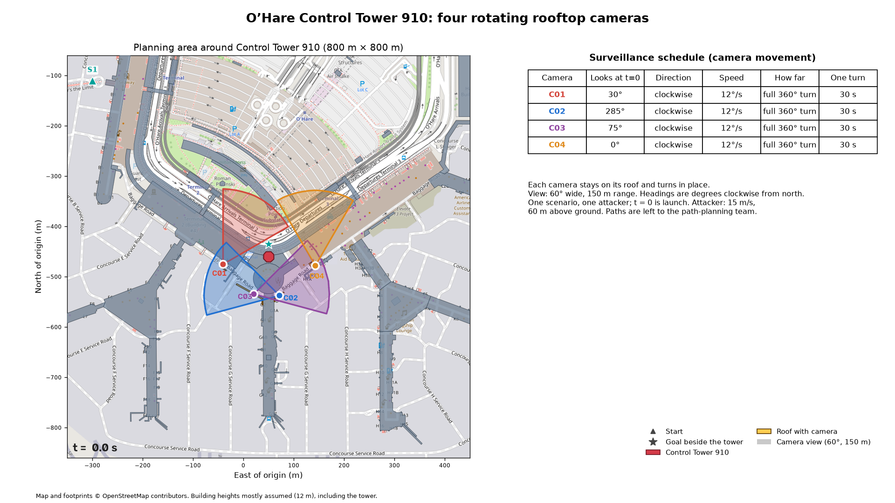

# ORD Control Tower 910: rotating-camera surveillance problem

Input for adversarial path planning. One attacker flies from a start point to a target beside ORD Control Tower 910
while four rooftop cameras rotate in place. The attacker's path is left to the planner.

## Inputs

| Input | Value / file |
|---|---|
| Map | 800 m × 800 m planning area centred on the tower (`planning_area_enu_m` in `problem.json`) |
| Building positions | `buildings_enu.geojson`: 124 outlines in ENU metres, with heights |
| Start | (−300.1, −109.8, −2023.2) m, north-west corner of the area |
| Goal | (49.9, −434.8, −2023.2) m, 25 m north of the tower centre |
| Attacker speed | 15 m/s, flying 60 m above ground |
| Surveillance schedule | each camera's `schedule` in `problem.json`; every camera view every 0.1 s in `camera_schedule_10hz.jsonl` |

## Cameras

Fixed on rooftops, 14 m above ground. They do not change position; they only rotate. t = 0 is the attacker launch.

| Camera | Position E, N, U (m) | Heading at t = 0 | Rotation |
|---|---|---|---|
| camera_01 | −41.2, −474.9, −2069.2 | 30° | clockwise, 12°/s, full turn every 30 s |
| camera_02 | 71.3, −537.2, −2069.2 | 285° | clockwise, 12°/s, full turn every 30 s |
| camera_03 | 20.3, −533.7, −2069.2 | 75° | clockwise, 12°/s, full turn every 30 s |
| camera_04 | 142.8, −477.6, −2069.2 | 0° | clockwise, 12°/s, full turn every 30 s |

Heading(t) = (heading at t = 0 + 12 × t) mod 360, in degrees clockwise from north.

**Seen:** the attacker is seen when it is within 30° either side of a camera's current heading and within 150 m
horizontally. Use this rule; height is ignored and buildings do not block views (all are lower than the attacker).
The camera intrinsics and tilt in `problem.json` are only for rendering images.

## Coordinates

Local east, north, up in metres, origin 41.980103° N, 87.903868° W at 2,250 m altitude (the same frame as the other
ORD datasets in this repository). Ground is z = −2083.2 m.

## Limits

- Most building heights are an assumed 12 m (no height in the map data), including the control tower.
- Camera positions come from a greedy placement against four corner-to-tower routes; headings and turn speed were not tuned.

`rotating_cameras.mp4` shows one 30 s turn in real time. Map data © OpenStreetMap contributors (ODbL).
